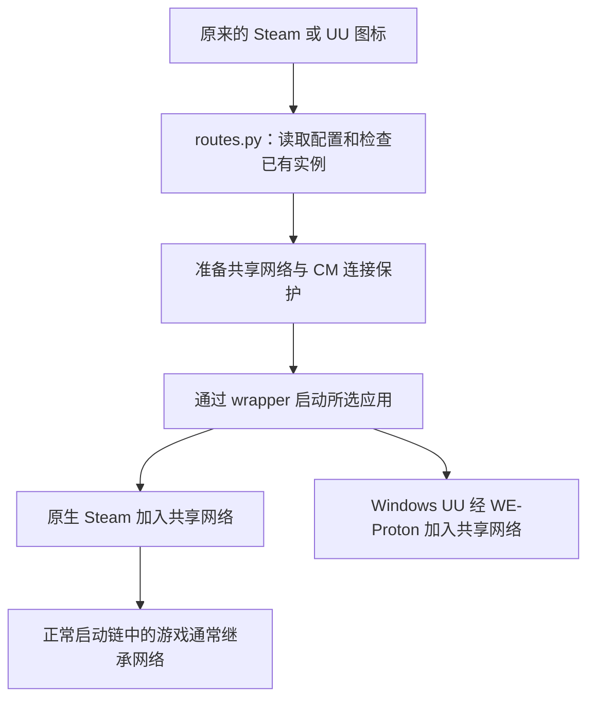
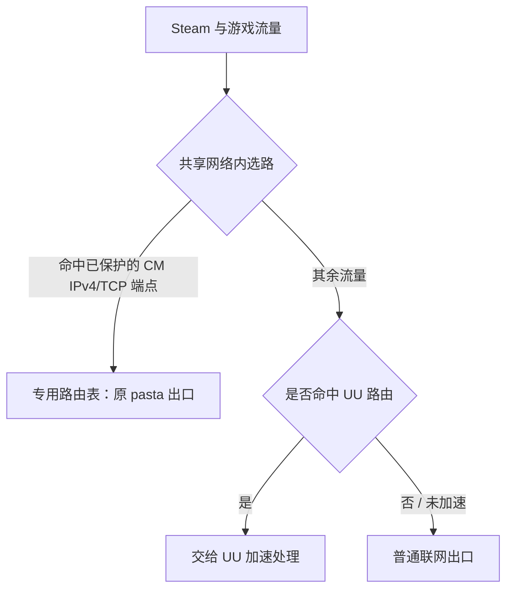

# 无感启动与加速切换：实现逻辑和代码导航

更新于 **2026-11-05**。维护者：**Felix Li，with OpenAI Codex assistance**。本页解释普通图标接入、共享网络、Wine 网卡修复与 Steam CM 连接保护如何配合，便于从使用行为定位到具体代码。

需要从下载材料开始逐步部署全部功能，请先读 [从零完整部署](FROM_ZERO.md)，其中包括固定运行器前提、完整 CLI、手动分解、首次 CM 准备、原图标接入、验收和回退。

## 这次具体解决什么

用户继续点击原来的 Steam 和网易 UU 图标，启动层自动准备共享网络，减少逐款游戏配置启动参数的操作。用户仍在 UU 中选择游戏、区服、路由模式和节点，以及开始或停止加速。点 Steam 只启动 Steam，点 UU 只启动 UU。

切换问题分为三个层面：Wine 是否返回当前有效网卡、重复校验是否造成性能回退、Steam 登录连接是否受 UU 路由切换影响。0062、0063 和 Python CM 保护分别处理这些问题。

| 名称 | 在这套方案里的职责 |
| --- | --- |
| Wine 前缀 | 保存 Windows 程序运行环境和配置；UU 有自己的前缀，各游戏仍使用 Steam 管理的前缀 |
| 网络命名空间 | 一套独立的网卡和路由；Steam、UU 及正常启动链中的游戏共享这套网络 |
| wrapper / keeper | 上游 wrapper 创建和复用网络会话；keeper 维持会话并在无成员后回收 |
| pasta | 把独立网络接到宿主的正常联网出口 |
| UU 虚拟网卡 | UU 加速期间建立的隧道接口，所选目标路由交给 UU 处理 |
| CM 控制连接 | Steam 维持登录和在线状态所用的 Connection Manager 连接，与游戏自身连接分别处理 |

## 一次普通图标点击怎样启动

首次设置由 [enable.py](../src/native-ux/enable.py#L121) 检查运行器、配置和必要的 UU 初始化，安装 Python 辅助文件，然后调用 [desktop.py](../src/native-ux/desktop.py#L72) 备份并修改用户级桌面入口的启动命令。原来的 desktop ID、图标、名称、Steam URI 参数及已识别的右键动作保留。

之后每次启动按以下流程执行：



图中 Steam 和 UU 是用户点击对应图标后的两个分支，不代表一次点击会同时启动两者。主要调度代码在 [routes.py::dispatch](../src/native-ux/routes.py#L75)：

1. 读取活跃配置，确定运行器、UU 前缀、客户端和网络入口。
2. 检查已有 Steam 的身份及网络归属。已有 Steam 在其他网络时提示正常退出重开，避免单实例机制把请求交给异网客户端。
3. 调用 `cm_guard.ensure()` 准备保护。新网络未创建时先通过 wrapper 建立网络；保护准备失败会通知，应用仍可按原流程启动。
4. 经诊断执行层调用 `uu-network-steam` 或 `uu-network-launch`，让 wrapper 启动所选应用。

启动参数与环境逐层传递，UU 专用运行选项不额外加给原生 Steam。重复点击已有同网 Steam 时，[steam_window.py](../src/native-ux/steam_window.py#L99) 尝试唤出可验证的 X11/XWayland 窗口；失败则通过受检查的入口发送游戏库 URI 请求。

## 为什么游戏通常不必逐个配置

配置中的 UU 前缀用于标识 wrapper 网络会话。上游 [proton-wrapper](https://github.com/SHORiN-KiWATA/proton-wrapper) 负责启动锁、创建或复用网络命名空间，以及 Wine 和原生程序的加入方式。先启动的一方创建网络，后启动的一方加入；同时启动时通过锁避免生成两套会话。

原生 Steam 位于这个网络后，其正常子进程链启动的游戏通常继承相同网络。各游戏的 Proton 版本、Wine 前缀和启动参数仍由 Steam 管理。第三方启动器或绕开入口的启动链需要另行核对，不能据此保证所有程序都继承成功。

UU 经 WE-Proton 运行，通过上游 Wintun 与路由 API，把虚拟网卡、地址和路由操作落实到这个独立 Linux 网络中。UU 按用户选择安装目标路由；pasta 提供基础联网出口。共享网络准备好，并不单独证明某个游戏流量已匹配加速路由或体验已改善。

## 0062 与 0063：修复接口身份和性能回退

### 0062：旧网卡记录失效

示例：第一次 `UU` 网卡的 Linux 索引为 **22**，停止后删除，再次创建的同名网卡索引变为 **23**。Wine 保留的旧记录如果仍参与查询，就可能返回旧索引或 LUID。这里的索引仅为说明用值。

[0062 补丁](../../../patches/wine/0062-nsiproxy-Ignore-stale-Unix-network-interface-entries.patch) 在使用记录前检查：

```text
if_nametoindex(记录中的名称) == 记录中的索引
```

名称与当前索引不匹配的项不再用于当前枚举及转换。旧分配继续保留，避免已经返回的字符串指针悬空。它不能识别同名同索引的再次利用；具体边界见 [0062 报告](../../fixes/0062-nsiproxy-live-interfaces/README.md)。

### 0063：同一次枚举复用成功结果

0062 增加实时校验后，大量路由指向同一接口时会反复检查同一张网卡。旧路由 API 的逐条操作又会触发表枚举，额外成本被放大。

[0063 补丁](../../../patches/wine/0063-nsiproxy-Reuse-interface-translations-within-a-route.patch) 为每次路由枚举建立局部成功转换缓存：同次枚举内复用，结束即释放，下次调用重新验证。失败转换不缓存；缓存分配失败也保留本次已成功取得的转换结果。

这样既保留失效检查，也消除新增的重复查询回退。没有跨调用或按时间保留旧接口身份，也没有提供并发热插拔的原子快照。[历史性能比较](../../network-integration/VALIDATION.md) 表明恢复接近原基底水平，不能推导为游戏延迟下降或整个加速启动时间缩短同样比例。详见 [0063 报告](../../fixes/0063-route-interface-cache/README.md)。

## CM 保护：让 Steam 在线连接保持原出口

网卡查询正确之后，UU 创建、接管或撤除路由仍可能影响 Steam 控制连接的出口或源地址。历史日志将停止加速和 CM 断线对齐，旧重连约需 22～34 秒；没有逐次证明所有断线都由同一种底层机制导致。

新增 Python 启动层在应用启动前准备精确保护：

1. **确认目标网络。** 校验 keeper 的用户、启动时间及命名空间，持有相应 user/net namespace 文件描述符。守护主进程留在宿主，通过固定 FD 进入已验证的私有网络执行规则操作。
2. **记录原出口。** UU 加速网卡尚未建立时，保存 pasta 出口的设备、接口索引、网关和源 IPv4 地址。存在 UU 网卡、出口不唯一或身份不明时不猜测基线。
3. **发现合格 CM 端点。** [endpoints.py](../src/native-ux/endpoints.py#L238) 使用 Valve CM 目录和严格匹配的 Steam CM 日志；原生 Steam 自有活跃 TCP socket 用来交叉确认并优先保护合格的活跃端点。目录中的合格候选也可提前保护，不要求每个目标先建立连接。任意 Steam socket 不自动取得 CM 资格。
4. **建立精确策略。** [policy.py](../src/native-ux/policy.py#L280) 在独立路由表中为目标放置 `/32` 原出口路由，再按“目的 IPv4＋TCP＋目的端口”添加优先于普通主路由表的选择规则。
5. **维护和回收。** [cm_guard.py](../src/native-ux/cm_guard.py#L205) 定期更新目标、检查网络身份及协调规则，按本程序账本清理。已使用不同源地址的活跃连接先暂缓接管，避免中途硬迁。



这张图表示逻辑选路；UU 自身连接节点仍需要基础联网出口。后续切换 UU 目标路由时，已保护的 CM 连接继续使用原 pasta 出口，游戏路由仍由 UU 管理。

规则只覆盖已发现的精确 IPv4/TCP CM 端点。同 IP 的其他端口和 UDP 不命中；其他程序访问相同 IP 与 TCP 端口仍会匹配。IPv6、未发现的新端点、下载 CDN、游戏自身连接和真实外网故障不在保证范围内。规则位于共享私有网络中，宿主路由不改动。

## 为什么关闭 UU 后 pasta 仍可能运行

pasta 服务于整个共享网络会话。即使 UU 已退出，只要 Steam、游戏或同网络的后台进程仍在，网络就仍有使用者。上游 keeper 检查除自身外的网络成员，确认没有成员并取得启动锁后再清理退出，继而结束 pasta。

CM 保护主进程留在宿主，只持有 namespace FD，不被 keeper 计为共享网络内成员。首次建网的短期桥接命令只是暂时保活；所有应用确已退出但网络长期不回收时，应按当时实际进程归属排查。

## 哪些工作属于本项目

| 来源 | 贡献边界 |
| --- | --- |
| SHORiN-KiWATA 的 WE-Proton | Wine 内置 Wintun 和相关接口、路由支持 |
| SHORiN-KiWATA 的 proton-wrapper | 网络会话、keeper、加入机制及其他上游桌面/会话能力 |
| passt / pasta 及 Linux | 用户态联网出口、网络命名空间等基础能力 |
| Felix Li，with OpenAI Codex assistance | 0062/0063、普通图标接入、启动核对、CM 精确保护，以及配套诊断、测试与文档 |

CM 保护位于 Python 启动层，本次没有重编 Wine/Proton。此前上游 PR 与后续本地集成分别维护；本页不表示上游已合并或认可全部工作。完整来源和逐组件许可见 [PROVENANCE.md](PROVENANCE.md)。

## 从说明找到代码与验证

| 需要审阅的行为 | 代码入口 |
| --- | --- |
| 安装和桌面入口备份/改写 | [enable.py](../src/native-ux/enable.py#L121)、[desktop.py](../src/native-ux/desktop.py#L224) |
| 普通图标调度、参数和已有实例检查 | [routes.py](../src/native-ux/routes.py#L44) |
| 调用 wrapper 启动原生 Steam 或 Windows UU | [uu_network.py](../src/test-runtime-felix/launchers/uu_network.py#L137) |
| 已有 Steam 窗口唤出 | [steam_window.py](../src/native-ux/steam_window.py#L99) |
| CM 保护准备、连接核对及后台维护 | [cm_guard.py](../src/native-ux/cm_guard.py#L81) |
| CM 目录、日志候选和活跃端点资格 | [endpoints.py](../src/native-ux/endpoints.py#L238) |
| 基线、精确规则、冲突检查和回退 | [policy.py](../src/native-ux/policy.py#L192) |

此前源码发布时，在原工作区与导出副本分别通过 **64 项集成测试和 16 项采集器测试**，无失败、错误或跳过。本次只增加说明与阅读链接，没有修改运行代码，也没有重新执行客户端切换或代码测试。

用户已确认本机原有切换掉线问题得到解决；没有与后续复测同步的整夜逐次断线时长记录，也没有异机全面验收。隔离测试、路由命中、客户端界面和游戏实际效果分别作为证据。运行器仍是本地预览，本仓库源码不附带固定历史运行器或客户端安装包。进一步阅读：[工作说明](WORK_REPORT.md)、[测试范围](TESTING.md)、[诊断和回退](DIAGNOSTICS.md)。
