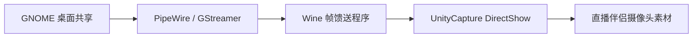

# 画面、声音与本地编码

## 画面链路

在 GNOME 授权共享目标桌面，由 Mutter ScreenCast 提供 PipeWire 视频流。GStreamer 输出 1280×720、30 fps RGBA。Wine 侧馈送程序校验帧序列和当前采集会话，再把画面交给 UnityCapture DirectShow 滤镜。在伴侣里添加摄像头素材 **Unity Video Capture**，用实际预览确认画面会更新。

先在隔离环境对自有变色窗检查像素、帧率和方向，再在伴侣内验证整桌面动态预览，最后录制实际游戏菜单。合成窗口本身出现在桌面上只能证明源存在，验收时需要确认伴侣预览或录像确实收到变化的帧。

此前伴侣的「窗口」捕获能够列出并选中窗口，建立 WGC 会话时曾遇到缺失的 D3D11 WinRT 互操作接口。这一阶段用摄像头桥完成实播。后续在专用 WGC 兼容路径上接通 Wayland 窗口，并验证原 Dock 版在遮挡期间持续更新。整桌面共享会包含前台窗口和通知，实播前需核对画面范围。[窗口后台复测](WINDOW_DOCK_RETEST.md)

## 声音和编码验证

| 测试 | 已验证内容 | 验证范围 |
| --- | --- | --- |
| Wine WASAPI 回采 | 独立端点收到 997 Hz 合成音，48 kHz 双声道 | 覆盖 Linux 音频到 Wine 回采 |
| Proton NVENC | 通过独立探针编码 H.264，合成 30 帧可完整解码 | 覆盖该运行时的 NVENC 调用 |
| 伴侣本地录像 | 前台游戏菜单约 16.8 秒，HEVC Main 720p30 共 502 帧，AAC-LC 48 kHz 双声道有声，完整解码 | 游戏输出与伴侣系统声音回采位于同一 monitor。游戏单独音轨、编码器硬件后端和精确同步仍待核验 |
| 用户实际开播 | 用户确认成功，媒体日志有 RTMP 启停 | 观众端画质和音质、长时间稳定性仍待验收 |

排查时先看系统输出与伴侣的系统声音源是否对应，再分别做合成回采和本地录像。原型没有改变默认音频输入或输出。

采集与馈送按应用会话管理。撤销时先停止专属馈送和桌面采集，再按安装账本确认并注销本前缀新增的摄像头滤镜。保留账号前缀、其他摄像头和系统音频配置。

UnityCapture 使用上游未修改的 x64 DirectShow 滤镜。固定来源及各组件原许可见上游仓库。[UnityCapture 受测版本](https://github.com/schellingb/UnityCapture/tree/3ed54c325e0ad71afcf4f246c07e5e17b3d7f2d2)

[返回直播总览](../STREAMING_COMPATIBILITY.md)
