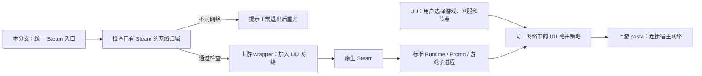

<!-- SPDX-License-Identifier: BSD-3-Clause -->

> 2026-11-05 更新：本文保留此前公开网络补丁与显式入口的历史范围。最新普通图标集成、Python CM 连接保护和当前验收请见 [Felix-Proton](../felix-proton/README.md) 与 [本轮工作说明](../felix-proton/docs/WORK_REPORT.md)。
# Felix Li 的新增工作与实现原理

本分支由 **Felix Li 在 OpenAI Codex 协助下**完成使用场景整合、问题复现、两项 Wine 网络修复、测试与公开代码整理。工作围绕两个实际需求展开：让原生 Steam 的标准启动链进入 UU 的网络，同时保留每款游戏原有运行环境；处理虚拟网卡反复创建、删除及大量路由增删时暴露的兼容问题。

这些新增工作建立在上游已经提供的能力之上：

| 责任范围 | 提供者与本分支的关系 |
| --- | --- |
| Windows 加速器兼容、Wintun 请求对接 Linux 虚拟接口、已有路由 API 支持 | WE-Proton 及 Wine、Proton 等上游。本分支沿用这些实现。 |
| 独立网络命名空间、会话保持与加入、pasta 连接宿主网络 | SHORiN-KiWATA 的 shorin-proton-wrapper 与 passt/pasta。本分支通过 CLI 调用，**没有修改或重新实现 wrapper**。 |
| Steam 统一入口、单实例网络检查、接口缓存过滤、枚举内缓存优化、便携配置与验证整理 | Felix Li 在 Codex 协助下新增的本分支代码。 |

精确上游版本、作者、补丁来源和许可证见[来源说明](PROVENANCE.md)。下面按“遇到什么问题、改了哪里、为什么有效”说明新增内容。

## 1. 统一 Steam 入口，同时保留游戏自己的前缀和环境

**问题。** UU 已经处于独立网络并设置路由时，一个早已在宿主网络运行的 Steam 不会自动迁移进去。Steam 又采用单实例机制：再次启动往往只是把 URI 或命令转交给已有客户端，表面上重新打开了界面，实际仍使用原来的网络。另外，将 UU 启动命令直接套到所有游戏上，容易把 UU 的 Wine 前缀、运行器或兼容选项带入游戏。

**修改与原理。** 新增三个职责明确的入口：`uu-network-launch` 启动 UU，`uu-network-run` 只让原生命令加入该网络，`uu-network-steam` 在此基础上检查 Steam 的单实例归属。Steam 入口通过 `/proc` 查找当前用户的原生 Steam 可执行程序，排除名称相同的 Python/Bash 启动脚本；如果发现已有客户端，就探测目标网络并再次检查进程。网络不同或无法确认时拒绝继续，提示用户正常退出重开，不自动结束 Steam 或游戏。



游戏通常继承父进程的网络命名空间，因此从这个 Steam 启动的标准子进程不必逐款重复配置网络入口。**共享的是网络，不是 Wine prefix**：游戏的 Proton 版本、`WINEPREFIX`、`STEAM_COMPAT_DATA_PATH`、AppId 和已有兼容选项仍由原来的启动链管理。UU 专用的 Fsync、WoW64、Xalia 和可选语言设置只在 UU 入口中设置，普通网络入口不额外注入这些选项。

参数处理也有一处针对实际问题的改动：上游 wrapper 会识别参数中的 `proton run` 等序列，直接传入嵌套游戏命令可能触发前缀选择逻辑。本分支用 `shlex.join` 将每个参数安全转义，组合为一个原生命令参数交给明确的 Bash 入口执行，避免外层误识别，同时保留空参数、引号、空格、Unicode 和 URI 内容。

**可观察收益。** 用户可以先在 UU 选好目标，再从一个固定 Steam 入口打开库；遇到宿主中的旧 Steam 实例，会收到明确提示，而不是无声地沿用错误网络。这里没有新增自动游戏检测：加速哪些地址由 **UU 当前选择的游戏、区服和节点所安装的路由策略**决定，选择“Steam 商店”不会自动得到所有游戏的策略。处于其他网络的已有 Steam 需要正常退出再重开；自行另建网络或委托宿主服务的第三方启动链也不能仅凭父进程继承保证覆盖。

代码：[入口、参数封装与环境分离](../integration/uu-network/uu_network.py#L115)、[进程识别与单实例守卫](../integration/uu-network/uu_network.py#L175)。历史实机验证覆盖 Steam 冷启动、已有客户端 URI 转交、Steam 启动服务及普通子进程、SteamLinuxRuntime 4 / sniper / soldier；没有由此推定真实游戏兼容性。进程检查也不是与所有外部启动器共享的原子锁，最终执行时仍存在外部并发启动的时间窗口。

## 2. 0062：过滤名称与索引对应关系已经失效的接口记录

**问题。** UU 切换目标时可能在同一个 Wine 服务生命周期内删除虚拟网卡，再以相同名字创建新网卡。Linux 已只剩当前接口，Wine 的接口表却可能仍枚举出旧的同名记录，按名称查询也可能得到已删除的索引。客户端随后依据这个过期结果操作接口，就会面对不一致的信息。

**修改与原理。** Wine `nsiproxy` 保留接口记录的内存，是为了让已经返回的名称指针继续有效；这并不意味着该记录应永远参与当前接口查询。0062 保留原分配，但在枚举及相关名称、索引、LUID 转换中增加：

```c
if_nametoindex(cached_name) == cached_index
```

它校验的是 **名称与索引的当前对应关系**。例如旧接口名为 `UU`、索引为 22，重建后的 `UU` 索引为 23，查询名称得到 23，旧的 `(UU, 22)` 记录便被排除。代码同时保持已有 synthetic Ethernet 兼容项的行为，并在真实 Ethernet 接口消失后重新判断兼容回退是否需要启用。

**可观察收益。** 在已复现的删除、同名不同索引重建场景中，Windows API 不再把旧记录当成当前接口，按名称查找能落到当前索引。这个判断不含接口“代数”或独立实例标识：**同名且同索引被复用时无法区分新旧实例**；既有 LUID 编码也不保证索引复用后旧 LUID 永远失效。因此它不是完整的接口实例生命周期识别机制，也不能单独解释所有连接失败。

代码：[0062 补丁](../../patches/wine/0062-nsiproxy-Ignore-stale-Unix-network-interface-entries.patch)、[生命周期探针](../tests/ndis_interface_lifecycle_probe.c)。历史候选的生命周期与改名/兼容边界检查合计 212 项通过；没有原生 Windows 或任意并发热插拔的完整验证。[修复说明](../fixes/0062-nsiproxy-live-interfaces/README.md)保留详细依据。

## 3. 0063：在一次路由枚举内复用转换，修复 0062 引入的性能回退

**问题。** 0062 增加了实时校验，却暴露出旧路由 API 的成本放大：每增加或删除一条路由，已有实现会完整扫描路由表；每行路由又要转换接口名、LUID 和索引。数千条路由往往引用同一个接口，于是相同校验被反复执行。3000 条测试路由的创建/删除由原来的约 **3.5 / 9.1 秒**变为约 **28.7 / 73.2 秒**。

**修改与原理。** 0063 只在一次内部 IPv4 或 IPv6 路由枚举调用中创建临时映射。第一次遇到某接口名时执行正常转换和 0062 的校验，随后同一次枚举中的其他路由复用成功的 `{name, LUID, index}` 副本。函数返回即释放：同一个公开 API 为统计数量、读取数据或重试而多次进入枚举时，每次都重新查询。失败转换不缓存，分配失败时仍使用已成功得到的结果，不因此丢弃有效路由。它不引入跨调用 TTL 缓存，不保留 NDIS 内部指针，公开接口和写入路径的校验仍保留。

**可观察收益。** 相同 PE64 探针、独立无外网容器、3000 条合成路由的三方对照为：

| 操作 | 原历史基底 | 仅 0062 | 0062 + 0063 |
| --- | ---: | ---: | ---: |
| 创建 3000 条路由 | 3.49 s | 28.73 s | 3.65 s |
| 删除 3000 条路由 | 9.12 s | 73.15 s | 9.72 s |

这是将 **本分支 0062 引入的回退恢复到接近原有水平**。旧 API 逐条操作、反复全表扫描的近似 O(N²) 成本仍在；0063 减少的是扫描期间重复接口查询的额外开销。它不改善节点 ping，也没有证明带宽或整个 UU 启动过程提速。0062 与 0063 应配套使用。

代码：[0063 补丁](../../patches/wine/0063-nsiproxy-Reuse-interface-translations-within-a-route.patch)、[性能探针](../tests/route_perf_probe.c)、[路由语义探针](../tests/route_interface_enumeration_probe.c)。各版本只做了一次完整增删循环，均无探针失败；[原始合成输出及完整条件](VALIDATION.md#合成路由性能)可复核。同一次枚举不是原子快照，接口在调用中途发生变化时，后续行可能沿用本次首次观察的对应关系。

## 4. 将本机修复整理成可配置、可审查的代码与证据

**问题。** 最初可用的脚本依赖个人目录、特定运行器和本机 Steam 字体启动器，直接复制并不能成为其他用户可用的方案；不同阶段的成功测试也容易被误读为“全部问题已解决”。

**新增工作。** 公开版本将前缀、运行器、wrapper、`STEAM_REAL` 等整理为 JSON 配置和环境覆盖；`STEAM_REAL` 默认使用 `/usr/bin/steam`，字体修复不再是依赖。启动前要求 wrapper 前缀配置确实启用了 `netns=1`，避免误配置时退回宿主网络；还拒绝明显的入口自递归，保持参数与错误输出边界。三个独立入口可直接从目录运行，不自动覆盖用户的 Steam 命令或桌面关联，也不捆绑客户端、账号前缀或上游二进制。

这部分提供 **45 项通过的隔离测试**，覆盖参数转义、环境保留、Steam 单实例判断、配置优先级、缺失网络配置与递归入口等。原部署的 26 项测试中有 25 项直接迁移；原来复制真实 wrapper 并改变 HOME 的一项，改成范围更窄的参数契约检查。新增测试没有运行真实 Steam、UU、Wine、pasta 或网络会话，因此公开参数化版本的 45 项结果与旧部署的实机证据分别说明。

代码与操作说明：[便携入口和配置](../integration/uu-network/README.md)、[网络与配置测试](../integration/uu-network/tests/test_network.py)、[Steam 守卫测试](../integration/uu-network/tests/test_steam.py)。网络补丁另有接口、IPv4/IPv6 路由语义和 Wine 自有测试对照：NSI 双方各 1453 项零失败；受控 IP Helper 双方保留相同的 45 个既有失败，不能写成全套全通过。

历史网络测试使用的运行器还含桌面补丁 0061，本次公开源码只包含 0062、0063，未重新完整构建并实测精简分支的整个运行器。真实使用中有一轮多目标加速与停止成功，也保留更早相同版本仍卡住的记录；创建虚拟网卡之前的部分等待尚未定位。这些剩余问题与已经证实的改动分别列在[验证结果](VALIDATION.md)，方便后续贡献者继续复现和改进。
