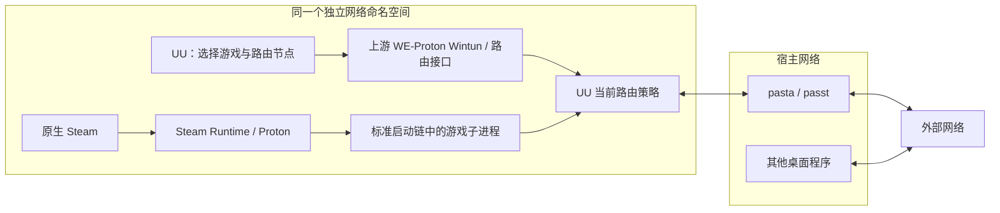

# UU 路由模式与 Steam 共享网络集成

本分支基于 [SHORiN-KiWATA/WE-Proton](https://github.com/SHORiN-KiWATA/we-proton) 的 `we-proton-ge11-11-31`（`4617d991`），并调用作者的 [shorin-proton-wrapper](https://github.com/SHORiN-KiWATA/proton-wrapper)。Windows 加速器支持、Wintun 兼容、网络命名空间与 pasta 连接方案来自上游。本分支的工作是 **原生 Steam 启动整合、两项 Wine 网络修复及验证整理**。完整作者、版本和许可证见 [来源与贡献边界](PROVENANCE.md)。这是独立 fork，不代表上游已接纳这些改动。

## 要解决的问题

UU 在独立网络中显示“正在加速”，并不意味着已经在宿主网络运行的 Steam 也使用该网络。原来逐游戏填写 wrapper 参数也容易将网络入口、游戏的 Proton 前缀和运行器选项混在一起。

本方案让原生 Steam 从统一入口进入 UU 的网络，标准游戏启动链继承该网络，而游戏自己的 Proton 版本、兼容前缀和启动参数继续由 Steam 管理。换游戏时在 **UU 内选择对应游戏、区服、路由模式和节点**；无需为标准 Steam 子进程逐款重复添加网络入口。

这不是按进程识别游戏的代理，也没有为每款游戏创建不同的命名空间。Steam 及其子进程共享一个网络，哪些目标地址经过加速由 UU 当前安装的路由策略决定。选择“Steam 商店”不等于选择了所有游戏的加速策略。

## 本分支新增内容

| 内容 | 实现 | 已建立的证据 |
| --- | --- | --- |
| Steam 共享网络入口 | [独立启动脚本](../integration/uu-network/README.md)：检查已运行 Steam 的网络归属；保留参数；拒绝错误网络中的单实例复用 | 原部署版本的隔离检查、实际 Steam 与三种 Runtime 探针；公开参数化版本另有隔离测试 |
| 不向游戏注入 UU 专用选项 | UU 启动入口与普通网络入口分离；安全封装 argv，避免 wrapper 把参数内的 `proton run` 误当成另一种启动请求 | 参数与环境隔离检查 |
| 过期接口身份过滤 | [0062](../fixes/0062-nsiproxy-live-interfaces/README.md)：接口名仍对应原索引时才采用缓存项 | 删除、重建、改名与兼容接口回归 |
| 修复上述补丁引入的性能退化 | [0063](../fixes/0063-route-interface-cache/README.md)：一次路由枚举内复用成功的接口转换，调用结束即释放 | 三方合成性能比较、路由语义回归与受控 Wine conformance |

0062 与 0063 应一起使用。0062 单独使用曾明显增加大路由表的增删耗时。0063 将其恢复到接近原运行器的水平，**不是宣称比原版加速八倍，也不是网络延迟降低八倍**。

## 使用入口

1. 先按上游说明准备 WE-Proton、shorin-proton-wrapper、passt/pasta 和已安装的 UU 前缀。要使用本分支的网络修复，运行器需包含 0062 与 0063；[构建说明](BUILD.md)提供源码路径。本仓库本次不发布成品运行器、UU 安装包或 prefix。
2. 按[启动脚本说明](../integration/uu-network/README.md)配置相同的 `UU_PREFIX` 和运行器，并在上游 wrapper 的该前缀配置中开启 `netns=1`。不要把游戏自己的前缀改成 UU 前缀。
3. 从 UU 专用入口启动客户端，在其界面选择所玩游戏、区服、路由模式和可用节点。
4. 正常退出原来在其他网络里的 Steam，再使用本项目的 Steam 入口启动。脚本不会代为关闭 Steam 或游戏。
5. 从这个 Steam 启动游戏。切换加速目标前先正常结束原游戏连接，再在 UU 中停止并切换目标。

共享网络可覆盖标准父子进程启动链；另一个已在宿主运行的服务、第三方启动器自行另建的网络、显式绕过本入口启动的 Steam，都不能凭此保证接入。网络接入也不等于游戏本体或反作弊兼容。

## 当前结果与限制

截至 2026-11-03：

- 已确认并修复接口缓存的旧身份问题，以及 0062 引入的额外路由枚举开销。
- 历史实机中已验证 Steam 冷启动、已有客户端接收游戏库 URI、Steam 启动服务及普通子进程、SteamLinuxRuntime 4 / sniper / soldier 的网络继承。**该验证没有启动真实游戏或反作弊组件**。
- 最新一轮用户复测中，两款加速目标能正常建立和停止；更早在相同 netfix2 版本上仍发生过第二款卡住。不能由最后一次成功宣称所有节点切换问题已永久解决。
- 启动加速仍可能等待 10–30 秒。一次有人工标记的测量将较大等待定位到创建虚拟网卡之前，尚不能区分本地初始化与远端等待。详见[验证与未解决项](VALIDATION.md)。
- 公开脚本进行了路径参数化和额外误配置检查；其新测试与原部署的实机证据分别列示，不将旧结果自动套到新代码。
- 本分支不包含桌面装饰、托盘、阴影或自由调整窗口大小的改动。历史网络测试使用的本地 desktop 基底与本次源码分支的差异已注明。

## 目录和继续排障

- [来源、作者、版本、许可证](PROVENANCE.md)
- [构建、探针与回退](BUILD.md)
- [验证结果、性能数据和已知限制](VALIDATION.md)
- [可配置的 UU / Steam / 通用命令入口](../integration/uu-network/README.md)
- [0062 接口身份修复](../fixes/0062-nsiproxy-live-interfaces/README.md)
- [0063 路由性能修复](../fixes/0063-route-interface-cache/README.md)

出现故障时先区分“进错网络”“UU 未建立路由”“节点不支持所选模式”和“游戏自身连接失败”。检查 namespace 相同只能证明网络位置相同；还需要确认 UU 接口、当前路由和实际业务连接。不要仅凭界面转圈、某一条 Wine 警告或节点延迟数值宣布根因。

公开仓库只包含代码、受控探针输出和整理后的证据。不包含账户资料、客户端数据库、游戏文件、真实网络流量或原始用户诊断日志。
